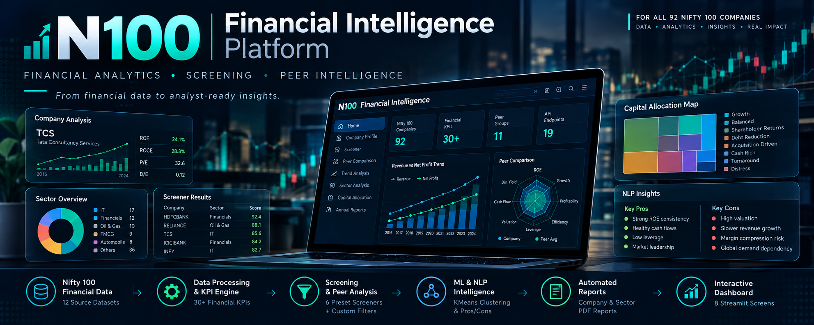

# AlphaIntel — Financial Intelligence Platform

A production-grade financial analytics and equity research workspace for a curated universe of Indian market leaders (Nifty 100).

The platform provides an end-to-end institutional-style analytics system combining an automated ETL pipeline, 30+ financial KPIs, multi-factor stock screener, peer benchmarking, cash flow analysis, K-Means clustering, rule-based pros/cons engine, PDF tearsheet generation, and a 19-endpoint FastAPI service with an interactive 8-screen Streamlit dashboard.

<p align="center">
  
  
  
  
  
  
  
  
  
  
</p>

---



---

## At a Glance

| Coverage | Analytics | Application | Quality |
|---|---|---|---|
| **92 companies** | **30+ financial metrics** | **8 Streamlit screens** | **170+ automated tests** |
| **13 SQLite tables** | **11 peer groups** | **19 REST endpoints** | **16 Data Quality rules** |
| **12 source datasets** | **6 screener presets** | **Automated PDF tearsheets** | **Cloud-deployable** |

---

## Core Capabilities

- **Financial Analytics & KPIs:** Profitability, leverage, efficiency, valuation, cash flow, and CAGR metrics across multi-year historical statements.
- **Company Intelligence:** Comprehensive company profiles, historical trends, KPI summaries, and automated pros/cons generation.
- **Multi-Factor Screener:** 6 preset investment screens plus custom multi-factor filtering across 10 financial metrics with composite ranking.
- **Peer Benchmarking:** 11 industry peer groups with percentile ranking and interactive radar charts.
- **Cash Flow Intelligence:** CFO quality, CapEx intensity, Free Cash Flow analysis, distress/deleveraging flags, and 8-pattern capital allocation classification.
- **Machine Learning & NLP:** K-Means clustering (5 behavioral clusters) with descriptive cluster profiling and rule-based qualitative insights (24 deterministic rules with confidence scoring).
- **Automated Reporting:** 91 company tearsheets, 10 sector overview reports, and a portfolio summary generated via ReportLab.
- **API-First Architecture:** Clean separation between data layer, FastAPI backend (19 endpoints), and Streamlit frontend.

---

## Dashboard Overview

The application features **8 dedicated screens**:

1. **Portfolio Overview (Home):** Macro portfolio KPIs, sector distribution, and company overview.
2. **Company Profile:** In-depth single-company fundamentals, financial statements, KPIs, and generated pros & cons.
3. **Financial Screener:** Multi-factor stock filtering engine with preset strategies and Excel export.
4. **Peer Comparison:** Head-to-head comparison within peer groups using percentile rankings and radar charts.
5. **Trend Analysis:** Multi-metric historical overlays and ratio trend charts.
6. **Sector Analysis:** Sector medians, Revenue vs. ROE distributions, and sector benchmarks.
7. **Capital Allocation:** Classification into 8 capital allocation profiles with interactive treemaps.
8. **Annual Reports:** Search and inspect annual report filings and financial documents.

---

## Architecture & Data Flow

```text
       Source Financial Datasets (12 datasets)
                         │
                         ▼
             [ETL & Normalization Layer]
                         │
                         ▼
             [16 Data Quality (DQ) Rules]
                         │
                         ▼
        [SQLite Analytical DB: nifty100.db (13 tables)]
                         │
                         ▼
        [Analytics, ML, Screener & NLP Modules]
                         │
                         ▼
        [FastAPI Backend Service (19 REST endpoints)]
                         │
        ┌────────────────┴────────────────┐
        ▼                                 ▼
[Streamlit Frontend (8 screens)]   [PDF Reports & Exports]
```

### Layer Responsibilities

| Layer | Responsibility |
|---|---|
| **Streamlit (`src/dashboard`)** | UI shell, filters, charts, interactive data tables, and PDF downloads |
| **API Client (`src/dashboard/utils`)** | Frontend-to-backend HTTP boundary and retry logic |
| **FastAPI (`src/api`)** | REST endpoints (`/api/v1`), Swagger UI, request validation |
| **Analytics (`src/analytics`)** | Ratios, CAGR, cash flow signals, peer rankings, clustering |
| **Screener (`src/screener`)** | 10-factor filtering, presets, and composite scoring |
| **NLP Engine (`src/nlp`)** | 24-rule deterministic investment pros & cons generator |
| **Reports (`src/reports`)** | PDF generation for company tearsheets, sectors, and portfolio |
| **Database (`db/`)** | Portable SQLite database (`nifty100.db`) with analytical schema |

---

## Project Structure

```text
AlphaIntel/
│
├── assets/                       # UI assets, diagrams, and screenshots
│   ├── screenshots/              # Dashboard preview images
│   ├── graph.png                 # Favicon / icon
│   ├── hero-banner.png           # Dashboard banner
│   └── sys-architect.png         # Architecture diagram
│
├── config/
│   └── screener_config.yaml      # Screener threshold presets and defaults
│
├── data/
│   ├── raw/                      # Raw source datasets
│   └── processed/                # Normalized CSV extracts
│
├── db/
│   ├── schema.sql                # SQLite schema definition
│   └── nifty100.db               # Analytical database (13 tables)
│
├── docs/
│   ├── openapi.json              # OpenAPI 3.0 REST schema
│   └── postman_collection.json   # Postman collection for API testing
│
├── notebooks/
│   └── exploratory_queries.sql   # SQL queries for exploratory data analysis
│
├── output/                       # Generated analysis artifacts and audit logs
│
├── reports/
│   ├── portfolio/                # Portfolio summary report
│   ├── radar_charts/             # Generated radar charts
│   ├── sector/                   # Sector analysis PDFs
│   └── tearsheets/               # Per-company 1-page financial tearsheets
│
├── src/
│   ├── analytics/                # Ratios, CAGR, clustering, peer benchmarking
│   ├── api/                      # FastAPI app and endpoint routers
│   ├── dashboard/                # Streamlit app and 8 screen modules
│   ├── etl/                      # Data ingestion, loading, and validation
│   ├── nlp/                      # Rule-based pros/cons generator
│   ├── reports/                  # PDF report generation pipelines
│   ├── screener/                 # Screener engine, presets, and ranking
│   └── testing/                  # Performance benchmarks
│
├── tests/                        # Pytest suite (ETL, KPI, DQ, Screener, API)
│
├── .gitignore
├── .python-version
├── LICENSE                       # MIT License
├── Makefile                      # Quick developer commands
├── render.yaml                   # Backend Render deployment configuration
├── requirements.txt              # Project dependencies
└── README.md                     # Project documentation
```

---

## Quickstart Guide

### 1. Clone the Repository & Setup Environment

```bash
# Clone the repository
git clone <your-repository-url>
cd AlphaIntel

# Create virtual environment
python -m venv venv

# Activate virtual environment
# Windows:
venv\Scripts\activate
# macOS / Linux:
source venv/bin/activate

# Install dependencies
pip install -r requirements.txt
```

### 2. (Optional) Run the Data Pipeline

If you want to re-run the ETL pipeline, compute indexes, and initialize the SQLite database from scratch:

```bash
# Ingest and validate data
python -m src.etl.loader

# Re-compute ratio indexes
python -m src.analytics.add_indexes
```

### 3. Launch Backend & Frontend

#### Terminal 1: Start FastAPI Backend
```bash
uvicorn src.api.main:app --port 8000 --reload
```
- API Base URL: `http://127.0.0.1:8000/api/v1`
- Swagger UI Documentation: `http://127.0.0.1:8000/docs`
- Health Endpoint: `http://127.0.0.1:8000/api/v1/health`

#### Terminal 2: Start Streamlit Frontend
```bash
streamlit run src/dashboard/app.py
```
- The dashboard will open at `http://localhost:8501`.

---

## REST API Overview

The FastAPI service exposes 19 REST endpoints under `/api/v1`:

| Method | Endpoint | Description |
|---|---|---|
| `GET` | `/api/v1/health` | Service health status and database connectivity |
| `GET` | `/api/v1/companies` | List all tracked companies with sector and market cap |
| `GET` | `/api/v1/companies/{ticker}` | Comprehensive company fundamentals and ratios |
| `GET` | `/api/v1/companies/{ticker}/ratios` | Historical financial ratios for a company |
| `GET` | `/api/v1/companies/{ticker}/tearsheet` | Download PDF company tearsheet |
| `GET` | `/api/v1/companies/{ticker}/documents` | Company annual report links |
| `GET` | `/api/v1/screener` | Multi-factor screener with query parameters |
| `GET` | `/api/v1/peers/{ticker}` | Peer group members and percentile rankings |
| `GET` | `/api/v1/sectors` | Sector aggregates and median KPI benchmarks |
| `GET` | `/api/v1/dashboard/summary` | Portfolio summary metrics for dashboard home |

Full API schema and Postman collections are available in [`docs/openapi.json`](docs/openapi.json) and [`docs/postman_collection.json`](docs/postman_collection.json).

---

## Running Automated Tests

Run the full automated test suite (ETL, Data Quality, KPIs, Screener, and API):

```bash
pytest tests/ -v
```

---

## Deployment

### Backend (Render / Cloud VM / Docker)
The FastAPI app can be deployed on Render using the included [`render.yaml`](render.yaml) or run inside any Python container with:
```bash
uvicorn src.api.main:app --host 0.0.0.0 --port $PORT
```

### Frontend (Streamlit Community Cloud)
1. Deploy `src/dashboard/app.py` directly to Streamlit Community Cloud.
2. In your Streamlit app settings, add the environment secret:
   ```toml
   N100_API_BASE_URL = "https://your-api-domain.com/api/v1"
   ```

---

## Disclaimer

This platform is developed strictly for **financial analytics, educational, and research purposes**. It does not constitute investment advice, financial endorsement, or securities recommendation. All calculations and signals should be independently verified before making financial decisions.

---

## License

This project is licensed under the [MIT License](LICENSE).